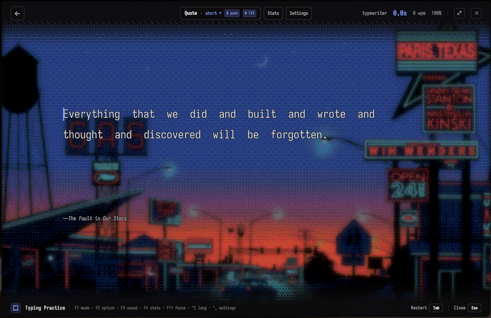

# oma-type

<div align="center">



<p align="center">
  <strong>Minimalist, ultra-low-latency typing practice engine inspired by Monkeytype &amp; Raycast.</strong><br>
  Runs natively inside <a href="https://omarchy.org">omarchy-shell</a> (Quickshell / Qt Quick) on Wayland (<code>wlr-layer-shell</code>) with out-of-process PipeWire mechanical switch acoustics.
</p>

<p align="center">
  <a href="https://github.com/Juanstudy/oma-type/actions/workflows/ci.yml"></a>
  
  
  
  
  
  
</p>

</div>

---

## ⚡ Why oma-type? (The Value)

Most typing practice tools run inside bloated Chromium/Electron wrappers or require keeping a browser tab open, resulting in DOM layout thrashing, garbage collection hitches, and 15–40 ms of input latency.

`oma-type` is engineered as a **native Wayland desktop layer surface** (`omarchy-shell` / Quickshell). It renders directly via the Qt Quick SceneGraph GPU pipeline with sub-millisecond keystroke responsiveness, instant desktop toggling, and sensory mechanical keyboard sound synthesis.

### 🏎️ Architectural Benchmarks & Proof

| Dimension | `oma-type` (Native Wayland) | Web / Electron Clones |
|---|---|---|
| **Input Latency** | **&lt; 1 ms** (Qt Quick hardware SceneGraph) | 15 – 45 ms (DOM event loop / IPC hops) |
| **Memory Footprint** | **~25 MB** (Shared Qt shell memory) | 250 MB – 600 MB (Isolated V8 heaps) |
| **Audio Synthesis** | **Out-of-process PipeWire** (`pw-play`) | WebAudio API (thread-blocking on GC) |
| **Window Shell** | **`wlr-layer-shell` overlay** (instant hotkey) | Traditional XWayland / Client window |
| **International Typing**| **Local dead-key composition** (no layer freeze) | Dependent on browser IME routing |
| **External Dependencies**| **Zero npm packages** | Hundreds of transitive packages |

---

## 🚀 Quickstart

### 1. Installation

```bash
cd ~/Projects/oma-type
bin/oma-type install
bin/oma-type doctor
```

### 2. Launching

* **Application Launcher (`oma-cast` / Rofi / Wofi):** Open your launcher (`Super + Space`), type `type` or `typing`, and press `Enter`.
* **Instant Hyprland Hotkey:** Add to `~/.config/hypr/bindings.lua`:
  ```lua
  o.bind("SUPER + SHIFT + T", "Typing Practice", "oma-type toggle")
  ```
* **CLI Quick Control:**
  ```bash
  oma-type toggle    # Seamlessly toggle overlay visibility
  oma-type show      # Open overlay
  oma-type hide      # Dismiss overlay
  oma-type reload    # Hot-reload QML plugin after edits
  oma-type doctor    # Run environment diagnostic checks
  ```

---

## 💎 Core Capabilities

### ⌨️ Tactile Acoustic Synthesis (PipeWire)
Realistic mechanical switch sound profiles powered by native Linux PipeWire (`pw-play`). Sound playback runs entirely out-of-process so audio generation never blocks the Qt GUI rendering thread:
* **Switch Profiles:** `thock`, `cream`, `topre`, `clicky`, `typewriter`, or `off`.
* **Dynamic Volume HUD:** Adjust volume on the fly (`Ctrl + Up` / `Ctrl + Down`) with visual floating HUD toast notifications.

### 🌐 Bilingual Linguistic Precision (English & Spanish)
* **Curated Collections:** 1,000 common English words, 1,000 common Spanish words (`spanish_1k`), and 500+ curated quotes with verified author attributions.
* **Wayland Dead-Key Handling:** Dedicated local composition pipeline ensures seamless typing of accented Spanish vowels (`á`, `é`, `í`, `ó`, `ú`) and `ñ` without input method layer freezes.

### 🎛️ In-Overlay Tactile Settings & Focus Mode
* **Instant Settings Panel (`Ctrl + ,`):** Slide-in tactile control plate with 100% opaque backing, category pills (`typing`, `sound`, `appearance`), and inline steppers.
* **Zen Focus Mode (`F11` / `Ctrl + Shift + M`):** Smoothly expands the typing arena from 1.0x windowed mode to a 1.35x distraction-free scale with eased typography.
* **Draggable & Resizable:** Move or resize the floating window anywhere on screen with ephemeral position memory.

### 🎨 Retro-Modern Bayer Dithering & Live Theming
* **Hardware Shader Pipeline:** Custom Bayer 8x8 dithering fragment shader with hardware-accelerated Gaussian blur.
* **Adaptive Palette Sync:** Automatically extracts and harmonizes UI accent colors with your active desktop wallpaper and Omarchy theme (`qs.Commons.Color`).

---

## 🎯 Keyboard Control Center

| Category | Primary Key | Secondary Shortcut | Action |
|---|---|---|---|
| **Modes** | `F1` | `Ctrl + M` | Cycle practice mode (`Time` → `Words` → `Quote`) |
| **Options** | `F2` | `Ctrl + L` / `Ctrl + D` | Cycle duration (`15s`/`30s`/`60s`), word count (`10`/`25`/`50`/`100`), or quote length |
| **Acoustics** | `F3` | `Ctrl + S` | Cycle switch sound (`thock` → `cream` → `topre` → `clicky` → `typewriter` → `off`) |
| **Volume** | `Ctrl + Up` | — | Increase volume (+5%) with floating HUD toast |
| **Volume** | `Ctrl + Down` | — | Decrease volume (-5%) with floating HUD toast |
| **Language** | `Ctrl + I` | — | Toggle language (`English` ↔ `Spanish`) with floating HUD toast |
| **Modifiers** | `Ctrl + P` | — | Toggle punctuation marks and capital letters (`punc`) |
| **Modifiers** | `Ctrl + N` | — | Toggle numbers injection (`123`) |
| **Views** | `F4` | `Ctrl + H` / `Ctrl + E` | Toggle Swiss-minimalist analytics graph &amp; stats |
| **Settings** | `Ctrl + ,` | — | Toggle in-overlay Settings Panel |
| **Zen Mode** | `F11` | `Ctrl + Shift + M` | Toggle 1.35x maximized / focus mode |
| **Flow** | `Tab` | — | Instant test restart with fresh text |
| **Flow** | `Space` | — | Advance word (skips incomplete word as incorrect) |
| **Flow** | `Esc` | — | Close overlay (or exit settings / stats view) |
| **Flow** | `Enter` | — | Restart test upon completion / return to typing |

---

## ⚙️ Configuration Reference

Preferences persist automatically to `~/.config/oma-type/settings.json` upon every change:

```json
{
  "mode": "time",
  "duration": 15,
  "wordCount": 25,
  "quoteLength": "short",
  "language": "english",
  "punctuation": false,
  "numbers": false,
  "soundTheme": "thock",
  "soundVolume": 0.55,
  "bgImageEnabled": true,
  "bgImagePath": "",
  "bgAdaptiveAccent": true,
  "bgDither": true
}
```

<details>
<summary><strong>View Schema Definitions &amp; Valid Values</strong></summary>

<br>

| Property | Type | Default | Description |
|---|---|---|---|
| `mode` | `string` | `"time"` | Active mode: `"time"`, `"words"`, or `"quote"` |
| `duration` | `number` | `15` | Timer duration in seconds: `15`, `30`, or `60` |
| `wordCount` | `number` | `25` | Target word count: `10`, `25`, `50`, or `100` |
| `quoteLength` | `string` | `"short"` | Quote filter length: `"short"` or `"medium"` |
| `language` | `string` | `"english"` | Target language: `"english"` or `"spanish"` |
| `punctuation`| `boolean`| `false` | Inject punctuation and capitalization |
| `numbers` | `boolean`| `false` | Inject numeric digits into test stream |
| `soundTheme` | `string` | `"thock"` | Switch sound: `"thock"`, `"cream"`, `"topre"`, `"clicky"`, `"typewriter"`, `"off"` |
| `soundVolume`| `number` | `0.55` | Audio volume from `0.0` (mute) to `1.0` (max) |
| `bgImageEnabled` | `boolean` | `true` | Enable translucent dithered wallpaper backing |
| `bgImagePath` | `string` | `""` | Custom image path (empty uses system wallpaper) |
| `bgAdaptiveAccent` | `boolean` | `true` | Harmonize UI accents with wallpaper palette |
| `bgDither` | `boolean` | `true` | Hardware Bayer 8x8 dithering shader |

</details>

---

## 🏛️ Architecture & Separation of Concerns

`oma-type` enforces a strict architectural boundary between headless business logic and the desktop presentation layer:

```text
┌─────────────────────────────────────────────────────────────┐
│                    Desktop Presentation                     │
│  (TypingOverlay.qml • components/ • Wayland wlr-layer-shell)│
└──────────────────────────────┬──────────────────────────────┘
                               │ delegates all logic
                               ▼
┌─────────────────────────────────────────────────────────────┐
│                     Headless Core (core/)                   │
│   Engine.js • Words.js • Quotes.js • Settings.js • Keys.js  │
│          (100% Pure CommonJS • Zero UI Dependencies)        │
└──────────────────────────────┬──────────────────────────────┘
                               │ verified by
                               ▼
┌─────────────────────────────────────────────────────────────┐
│                 Test Suite (Node.js &amp; Bun)                  │
│       node:test &amp; node:assert/strict • tests/*.test.js      │
└─────────────────────────────────────────────────────────────┘
```

* **Headless Core (`core/`):** Pure CommonJS containing the state machine, WPM/accuracy math, word slicing, and dead-key composition. Completely decoupled from Qt, QML, and browser APIs.
* **Presentation Layer (`components/`):** Declarative Qt Quick / QML handling Wayland layer-shell positioning, tactile input events, and hardware shaders.
* **Testing Protocol:** Run natively with zero setup:
  ```bash
  npm test   # Native Node.js test runner
  bun test   # Bun runtime verification
  ```

---

## 📄 License

Distributed under the [MIT License](LICENSE). Built with ❤️ for the [Omarchy](https://omarchy.org) ecosystem.
